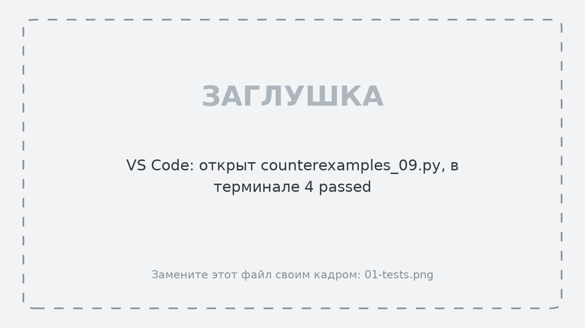

# Домашняя работа № 9 · Шесть кандидатов, одна задача

**Дисциплина:** ОП.04 «Основы алгоритмизации и программирования»

| Поле | Значение |
|---|---|
| Фамилия, имя, отчество |  |
| Группа |  |
| Номер работы | 9 |
| Тема работы | Разбор шести решений задачи «повтор рядом» |
| Дата сдачи |  |
| Ветка | `hw-09` |

Часть бланка уже заполнена. Замените `___` своими ответами.

---

## 1. Чтение решений

Заполните до запуска гонки. Время оценивайте через n (длина списка) и k.

| Решение | Время | Верно? |
|---|---|---|
| A | O(n·k): вложенный цикл по следующим k проходам | да |
| B | ___ | ___ |
| C | ___ | ___ |
| D | ___ | ___ |
| E | ___ | ___ |
| F | ___ | ___ |

В решении B нет вложенного `for`. Где в нём спрятан второй цикл: ___

---

## 2. Две ошибки

Контрпримеры записаны в `counterexamples_09.py`. Здесь объясните по коду,
что идёт не так и какую строку исправить.

Первое ошибочное решение ___: ___

Второе ошибочное решение ___: ___

Как вы искали ошибки: чтением кода, стресс-тестом или и так и так: ___

Одно из ошибочных решений проходит все три примера из условия. Какое,
и какого примера в условии не хватает, чтобы его поймать: ___

---

## 3. Гонка

Совпала ли гонка с вашей таблицей: у каких решений время растёт вместе с k: ___

A и B — оба O(n·k), но B заметно быстрее. Почему, если сложность одинаковая: ___

---

## 4. Решение интервьюера

C и D работают за O(n). Какое из них вы бы взяли и в каком случае
выбрали бы другое: ___

---

ИИ: не использовал / использовал для ___
