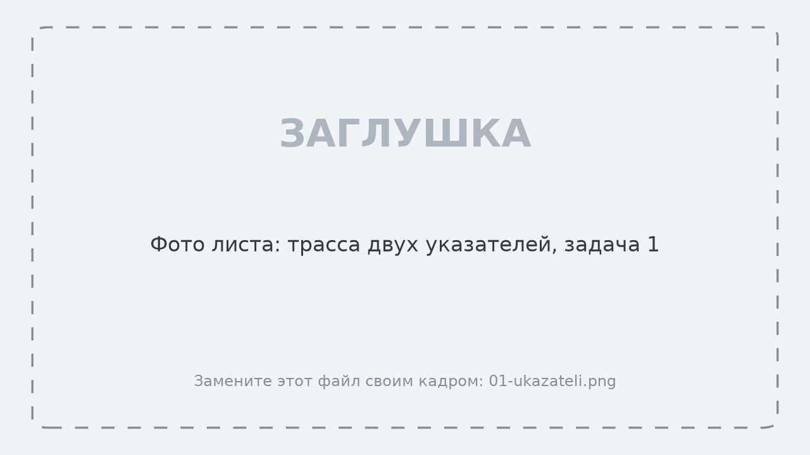
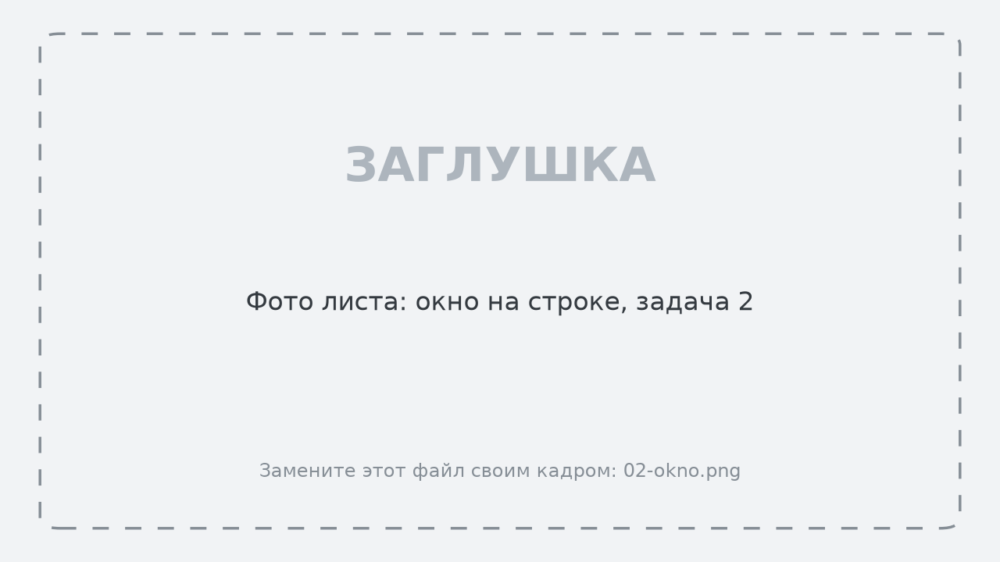

# Домашняя работа № 10 · Трассировка на бумаге

**Дисциплина:** ОП.04 «Основы алгоритмизации и программирования»

| Поле | Значение |
|---|---|
| Фамилия, имя, отчество |  |
| Группа |  |
| Номер работы | 10 |
| Тема работы | Ручная трассировка: указатели, окно, кэш |
| Дата сдачи |  |
| Ветка | `hw-10` |

Часть бланка уже заполнена. Замените `___` своими ответами.

---

## 1. Пара с суммой

Ответ функции и сколько шагов сделал цикл: ___

На первом шаге сумма 1 + 11 = 12 больше 10, и `right` сдвигается.
Почему число 11 больше ни с кем не нужно проверять: ___

---

## 2. Самая длинная подстрока без повторов

Ответ функции и сама подстрока: ___

При `right = 3` (буква `b`) цикл `while` убирает две буквы. Почему мало
убрать одну `b`: ___

Внутри `for` есть `while`, но время O(n). Сколько раз каждая буква может
войти в окно и выйти из него: ___

---

## 3. LRU и FIFO, кэш на 3 места

Кэш после каждого запроса записывайте от самого старого ключа к самому новому.
Попадание `get` отметьте знаком ✓, промах — знаком ✗.

| Запрос | LRU | FIFO |
|---|---|---|
| put a, b, c | a, b, c | a, b, c |
| get a | ✓ b, c, a | ✓ a, b, c |
| put d 4 | c, a, d (вытеснен b) | ___ |
| get b | ___ | ___ |
| get c | ___ | ___ |
| put e 5 | ___ | ___ |
| get a | ___ | ___ |
| get d | ___ | ___ |

Попаданий из пяти `get`: у LRU ___, у FIFO ___.

В модуле 20 на большом потоке запросов LRU давал больше попаданий, чем FIFO.
Почему здесь вышло иначе и что из этого следует для выбора политики: ___

---

ИИ: не использовал / использовал для ___
