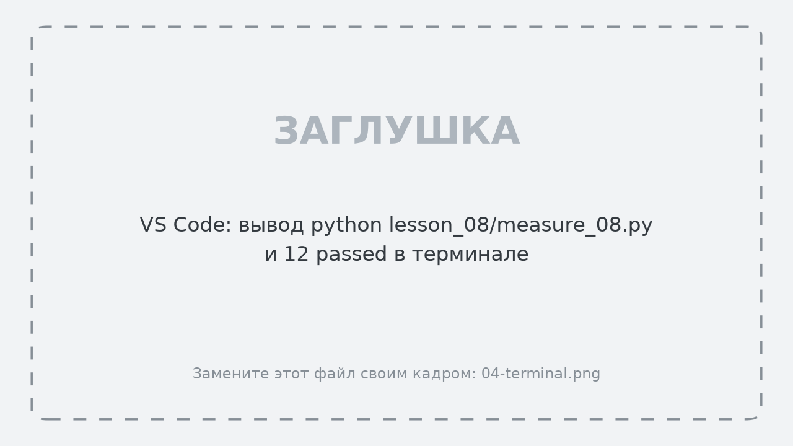
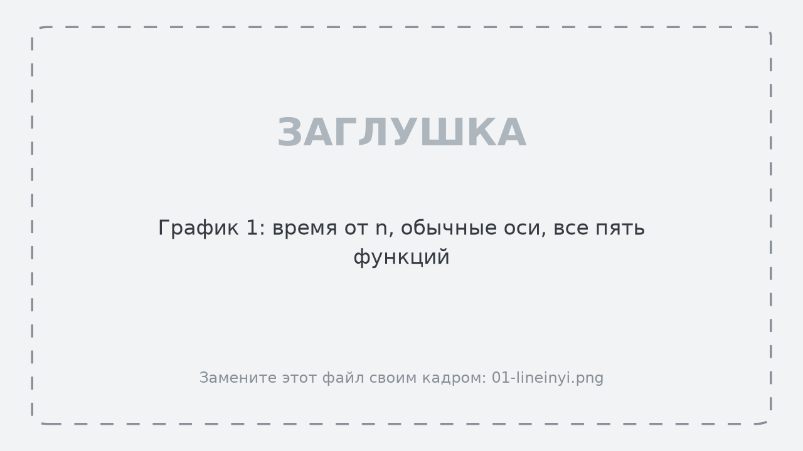
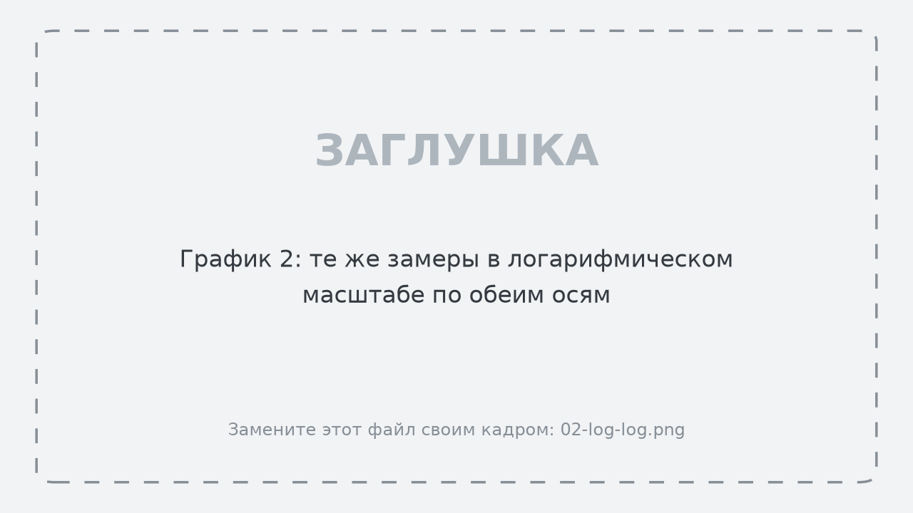
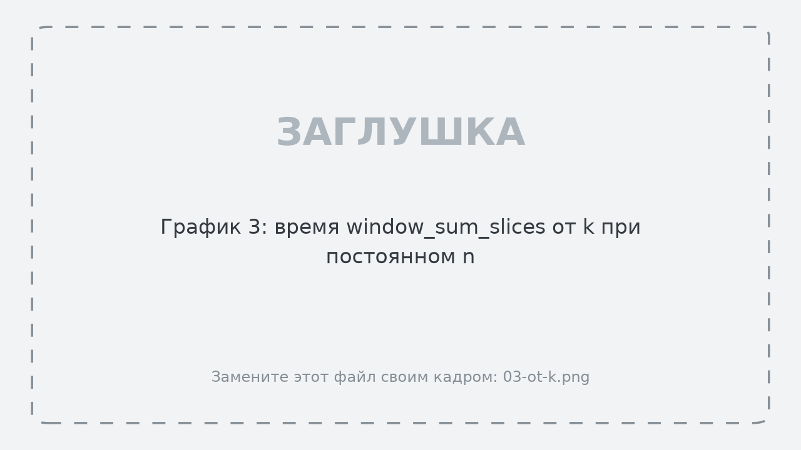

# Домашняя работа № 8 · Сложность по замерам и графикам

**Дисциплина:** ОП.04 «Основы алгоритмизации и программирования»

| Поле | Значение |
|---|---|
| Фамилия, имя, отчество |  |
| Группа |  |
| Номер работы | 8 |
| Тема работы | Замер пяти функций, рост при удвоении, графики |
| Дата сдачи |  |
| Ветка | `hw-08` |

Часть отчёта уже заполнена. Замените `___` своими ответами.

---

## 1. Прогноз и замер

Прогноз заполните до запуска `measure_08.py`, по описаниям функций (docstring).
Ошибиться можно: замер покажет, где прогноз неверен. Рост при удвоении
возьмите из вывода программы, у последнего удвоения 8 000 → 16 000.

| Функция | Прогноз | Рост при удвоении | Сложность по замеру |
|---|---|---|---|
| `window_sum_slices` | ___ | ___ | ___ |
| `window_sum_shift` | O(n): один проход | 1,96 | O(n) |
| `merge_intervals` | ___ | ___ | ___ |
| `unique_in_order_list` | ___ | ___ | ___ |
| `unique_in_order_set` | ___ | ___ | ___ |

В строке `window_sum_shift` стоит пример с одного компьютера. Замените рост своим.

---

## 2. Графики

Какие линии на графике 2 идут круче остальных и что это значит: ___

`merge_intervals` с сортировкой и `window_sum_shift` с одним проходом растут
почти одинаково. Можно ли по пяти точкам отличить O(n log n) от O(n)
и как бы вы поставили опыт, чтобы отличить точнее: ___

---

## 3. Загадочная функция

В `unique_in_order_list` всего один цикл по списку. Совпал ли замер
с вашим прогнозом? Какая строка кода определяет сложность и почему она
не O(1): ___

Сколько времени она заняла бы на 1 000 000 чисел? Это в 62,5 раза больше,
чем 16 000. При O(n²) время вырастет примерно в 62,5² ≈ 3 900 раз:
___ с × 3 900 ≈ ___ мин.

---

## 4. Время от длины окна

n = 10 000 не меняется, меняется только k. Окон n − k + 1, в каждом k чисел.

Почему график поднимается, а потом падает почти до нуля при k = n: ___

Какая сложность у `window_sum_slices` через n и k, и почему в разделе 1
она вела себя как O(n²): ___

---

## 5. Вывод

Чего вы не увидели бы в коде без замера: ___

---

ИИ: не использовал / использовал для ___
